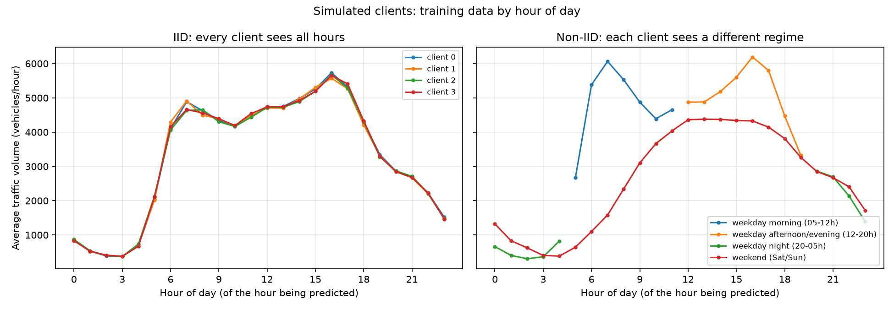
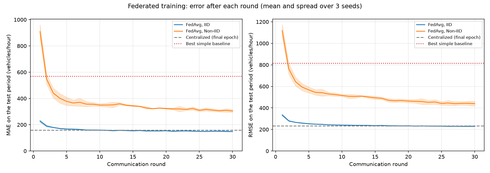
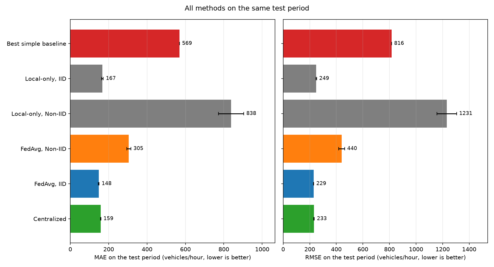
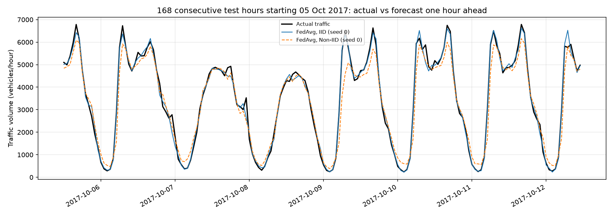
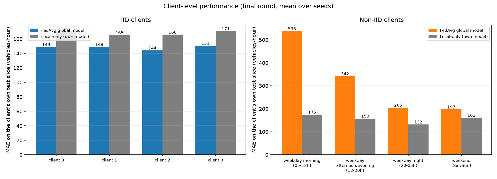
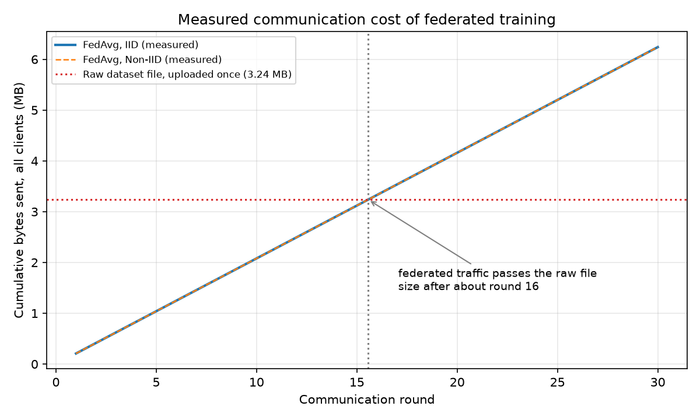

# Federated Traffic-Flow Prediction (PS-003)

A reproducible simulation of **federated learning** for hourly traffic forecasting. Several simulated
intersections train a small neural network together; in this simulation only model weights (and an example
count) travel to a central server, never raw traffic records. Built for the AIORI hackathon (Level 2).

**Live demo:** `LIVE_DEMO_URL` (to be filled in after deployment).
Free hosting sleeps when idle, so the first load can take about a minute.
No internet? Run the demo locally: see [Run the demo](#6-run-the-demo).

> **Read this first.** The "intersections" are *simulated slices of one sensor's data*, not real separate
> intersections. Federated learning alone is *not* full privacy. On this small dataset federated training
> sent *more* bytes than uploading the raw file once (measured, see [Communication](#communication-measured)).

## 1. The problem and the idea

Sending every raw sensor reading to one cloud server uses bandwidth and builds a detailed record of vehicle
movement. In **federated learning** each site trains on its own data and sends only the learned numbers
(weights). The server averages them with **Federated Averaging (FedAvg)** and sends the improved model back.
This repeats for several rounds.

FedAvg is an existing algorithm (McMahan et al., 2017); we do not claim it is new. Our contribution is a
tested, reproducible simulation that measures prediction error, communication cost and the effect of
similar (IID) versus different (Non-IID) clients.

```
 public dataset -> clean -> time split -> scale (train only) -> windows
                                     |
                      partition into 4 simulated clients (IID or Non-IID)
        +-----------+-----------+-----------+-----------+
        | client 0  | client 1  | client 2  | client 3  |   raw windows stay here
        |  local    |  local    |  local    |  local    |
        |  training |  training |  training |  training |
        +-----+-----+-----+-----+-----+-----+-----+-----+
              |  weights + n_k (bytes only)   ^  global weights
              v                               |
            +-----------------------------------+
            |  server: w_global = sum (n_k/N) * w_k   (FedAvg)
            +-----------------------------------+
```

## 2. Data

* **Dataset:** Metro Interstate Traffic Volume, UCI Machine Learning Repository (Hogue, 2019):
  hourly westbound I-94 traffic near Minneapolis-St Paul, USA, one sensor, 2 Oct 2012 - 30 Sep 2018,
  48,204 rows. <https://archive.ics.uci.edu/dataset/492/metro+interstate+traffic+volume>.
  License: see the UCI page (to be confirmed by the team).
* **Not India-specific.** This dataset is from the USA. An Indian dataset could be a second case study in
  future work, but none has been verified or used here.
* **Target:** `traffic_volume`, vehicles per hour. **Task:** forecast the next hour from the previous 24 hours
  plus hour-of-day and day-of-week.
* **Cleaning (decided from the data):** duplicate timestamps (5,445, all with identical traffic) are merged;
  11,976 of 52,551 hours are missing in 2,588 gaps, the longest 307 days; only gaps of 3 hours or less are
  filled (straight line); longer gaps stay empty and no example ever crosses a gap. Weather and holiday columns
  are not used (impossible values, sparse labels).
* **Split:** chronological, first 80% of usable hours for training (until 4 Oct 2017), the rest for testing.
  The scaler is fitted on training data only; examples are built after the split, separately for train and test.
* **Result:** 28,324 training and 8,584 test examples, 28 inputs each.
* **A leak we found and fixed:** a straight-line fill contains the real value that follows the gap, so
  predicting the hour after a filled gap would be artificially easy. Such targets (4,655 training and 38 test
  examples) are now excluded, and every result was regenerated. See `tests/test_preprocess.py`.

## 3. Simulated clients

| Setting | How the 4 clients are made |
|---|---|
| **IID** | Training examples shuffled with a fixed seed and dealt out in equal shares (7,081 each). |
| **Non-IID** | One client per traffic regime of the hour being predicted: weekday morning (05-12h, 5,805 examples), weekday afternoon/evening (12-20h, 6,595), weekday night (20-05h, 7,728), weekend (8,196). |

Client mean traffic differs by about 100 times more in the Non-IID split (spread 1,561 versus 16 vehicles/hour).
The Non-IID rule is deliberately extreme (each client never sees three quarters of the day) and is a simulation
device, not real intersections.



## 4. Model and training

* **Model:** MLP 28 -> 64 -> 64 -> 1 (6,081 parameters, PyTorch), MSE loss, Adam (learning rate 0.001), batch 64.
* **Federated:** 4 clients, 30 rounds, 2 local epochs per round, FedAvg weighted by `n_k`.
* **Centralized baseline:** 60 epochs on all training data (same number of passes as 30 x 2).
* **Local-only baseline:** each client trains alone for 60 epochs, nothing shared.
* **Seeds:** 0, 1, 2 for everything; settings live in `configs/default.yaml`.
* The server only ever receives **bytes** containing weights and one integer (the example count); a test checks this.

## 5. Results (test period 5 Oct 2017 - 30 Sep 2018)

Vehicles per hour, lower is better; mean +/- standard deviation over 3 seeds, final epoch/round.

| Method | MAE | RMSE | Bytes sent during training |
|---|---|---|---|
| Always predict the training average | 1728.3 | 1974.2 | 0 |
| Repeat the last hour | 588.3 | 815.5 | 0 |
| Same hour yesterday | 569.2 | 1028.2 | 0 |
| Centralized MLP | 158.6 +/- 0.8 | 232.6 +/- 2.0 | raw data must be uploaded |
| Local-only, IID clients | 167.3 +/- 4.8 | 248.9 +/- 2.9 | 0 |
| Local-only, Non-IID clients | 837.9 +/- 66.0 | 1231.2 +/- 74.1 | 0 |
| **FedAvg, IID clients** | **148.2 +/- 1.9** | **229.0 +/- 1.0** | 6,240,000 |
| **FedAvg, Non-IID clients** | **304.8 +/- 10.8** | **439.9 +/- 22.4** | 6,240,000 |

How to read it:

* **IID:** FedAvg matches centralized training (we do not claim it is better; the centralized error moves by
  10-15 between epochs) and is about 11% lower in MAE than local-only training.
* **Non-IID:** FedAvg's error is about twice the IID value and varies more between seeds, but it is still about 46%
  below the best simple baseline. Local-only models collapse on the shared test period (worse than the simple
  baselines) because each saw only one kind of traffic. This gap comes from our extreme partition and should not
  be generalized.
* **Client level:** on its own test slice, each Non-IID local specialist beats the shared FedAvg model
  (MAE, mean over seeds: weekday morning 175 vs 538, afternoon/evening 158 vs 342, night 132 vs 205,
  weekend 162 vs 197), so the global model is more general but less accurate for each regime. With IID clients
  FedAvg is better for every client (about 148 vs 168 on average). See the client-level figure below.
* **Robustness check:** because the error wobbles from epoch to epoch, `src/secondary_check.py` (output:
  `results/secondary_check.json`) averages the last 10 epochs/rounds instead of the final one:

| Method | Final MAE | Last-10 MAE | Final RMSE | Last-10 RMSE |
|---|---|---|---|---|
| Centralized (epochs) | 158.6 +/- 0.8 | 155.1 +/- 0.5 | 232.6 +/- 2.0 | 232.0 +/- 1.0 |
| FedAvg, IID (rounds) | 148.2 +/- 1.9 | 150.4 +/- 1.7 | 229.0 +/- 1.0 | 230.5 +/- 1.5 |
| FedAvg, Non-IID (rounds) | 304.8 +/- 10.8 | 313.9 +/- 9.3 | 439.9 +/- 22.4 | 448.1 +/- 18.7 |

  The apparent MAE gap between FedAvg IID and centralized shrinks from about 6% to about 3% and the RMSE
  values are nearly equal, so we only claim that FedAvg IID **matches** centralized training. FedAvg Non-IID
  was still improving slowly at round 30; its last-10 MAE is about 45% below the best simple baseline.
  Differences below roughly 10-15 vehicles/hour should not be treated as meaningful.






### Communication (measured)

* One client update is 26,130 bytes (24,324 bytes of weights plus archive headers); the server broadcast is 25,870.
* A round (4 uploads + 4 downloads) is **208,000 bytes**; 30 rounds are **6,240,000 bytes**, which is
  **1.93 times the raw dataset file** (3,237,208 bytes). Break-even is at about round 16.
* **So on this small static dataset federated training does not save bandwidth.** Its cost is fixed per training
  campaign, while the cost of sending raw data grows with how much is streamed (for example video). The repository
  prints an assumption-based illustration of this (`results/communication_analysis.json`); it is labeled as an
  assumption, not a measurement.



## 6. Run the demo

The demo replays saved **historical** test data through the saved FedAvg models (plain NumPy, no PyTorch).
There is no live feed and nothing is trained.

```
pip install flask                      # if not already installed
python deploy\prepare_demo_data.py     # once, from the project root
python deploy\app.py                   # open http://127.0.0.1:5000
```

Hosting (for example Render): root directory `deploy`, build command `pip install -r requirements.txt`,
start command `gunicorn app:app`. The `deploy` folder contains its own small `requirements.txt`
(Flask, NumPy, gunicorn; no PyTorch).

## 7. Reproduce everything (Windows PowerShell, from the project root)

```
python -m venv venv
venv\Scripts\activate
pip install -r requirements.txt
python src\check_env.py
python src\download_data.py
python src\preprocess.py
python src\baselines.py
python src\partition.py
python src\centralized.py
python src\federated.py --scheme iid
python src\federated.py --scheme noniid
python src\local_only.py
python src\analysis.py
python src\secondary_check.py
python -m pytest tests -v
```

Tested on Python 3.14 (Windows); the test suite has 76 tests. Each script prints what it saved. Results and
figures are committed in `results/` and `figures/`.

## 8. Repository layout

```
configs/default.yaml     all settings          src/preprocess.py    clean, split, scale, windows
src/download_data.py     fetch the dataset     src/partition.py     IID / Non-IID clients
src/inspect_data.py      look at raw data      src/model.py         MLP + training helpers
src/baselines.py         simple baselines      src/client.py        local training
src/centralized.py       centralized run       src/server.py        FedAvg
src/local_only.py        no-sharing baseline   src/comm.py          messages and byte counting
src/federated.py         federated runs        src/analysis.py      table, figures, communication
src/numpy_model.py       NumPy forward pass    src/secondary_check.py  last-10 average check
deploy/                  demo web app          tests/               automated tests
results/, figures/       saved evidence        docs/                presentation outline
```

## 9. Limitations and future work

* One US sensor; clients are simulated; neighbouring examples overlap, so IID clients are not independent.
* 6.4% of usable hours are interpolated estimates and 17.5% of the full period is missing.
* The test period is one year at one location; no India-specific data; only an MLP is evaluated.
* Under the Non-IID split the shared model does not beat local specialists on their own data.
* Weather, holidays and a stronger seasonal baseline are not included.
* **Privacy:** model updates can leak information. Secure aggregation and differential privacy are *not*
  implemented (future work). This is a simulation, not a deployment on real roadside hardware.
* Future work: real multi-intersection data (for example a verified Indian dataset), LSTM, weather features,
  longer Non-IID training, smaller or quantized messages, secure aggregation.

## 10. Team and acknowledgements

Shaurya and Md Nayab Ahmad (first-year students); mentor Dr Sumit Raj. The team used an AI assistant (Claude)
as a mentor and code-drafting aid and ran every experiment on its own laptops.

## References

* McMahan, H. B., Moore, E., Ramage, D., Hampson, S., Aguera y Arcas, B. (2017). *Communication-Efficient
  Learning of Deep Networks from Decentralized Data.* AISTATS 2017.
* Hogue, J. (2019). *Metro Interstate Traffic Volume* [Dataset]. UCI Machine Learning Repository.
  <https://archive.ics.uci.edu/dataset/492/metro+interstate+traffic+volume>
